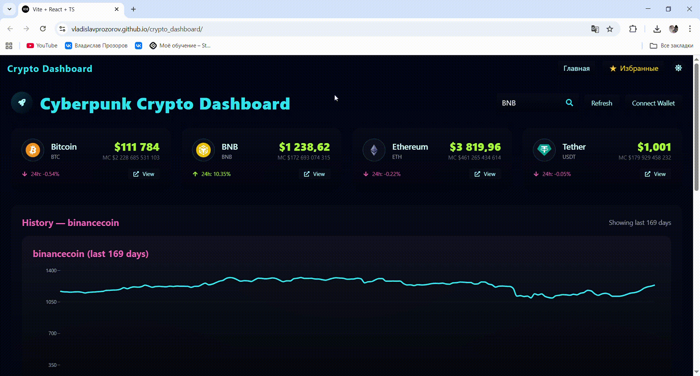

# Crypto Dashboard

Интерактивная платформа для отслеживания криптовалютных рынков в реальном времени.  
Разработана с акцентом на **чистую архитектуру (Feature-Sliced Design)**, **TypeScript**, и **живое обновление данных через WebSocket**.

## Демо

Сайт доступен по ссылке: [Crypto Dashboard Desktop Live](https://vladislavprozorov.github.io/crypto_dashboard/)


## О проекте
**Crypto Dashboard** — это современный дашборд для мониторинга криптовалют:
- обновление цен в **реальном времени (WebSocket Binance API)**;
- интерактивные графики и метрики;
- модульная архитектура по принципам **FSD (Feature-Sliced Design)**;
- чистый код, строгая типизация и масштабируемая структура.
## Функционал
- **Live-обновления цен** | Подключение к Binance WebSocket API с автоматическим реконнектом |
- **Crypto Dashboard** | Отображение ключевых криптовалют с динамическим изменением котировок |
- **FSD архитектура** | Разделение логики по слоям (`app`, `features`, `pages`, `shared`) |
- **UI-компоненты** | Адаптивный интерфейс с Tailwind CSS и анимациями |
- **Модульность** | Каждый модуль изолирован и легко расширяется |
- **TypeScript everywhere** | Полная типизация для API, хуков и UI
- **Vite + React 18** | Быстрая сборка и мгновенная разработка |

## Архитектура проекта
Проект структурирован по модульно-функциональному принципу для удобства масштабирования и поддержки.
```
src/
├── api/             # Работа с внешними API
│   └── crypto.ts    # Запросы к API криптовалют
├── app/             # Инициализация приложения
│   ├── layout.tsx
│   ├── router.tsx
│   └── providers.tsx
├── assets/          # Медиа-файлы, изображения, иконки
├── features/        # Функциональные модули приложения
│   └── coins/       # Модуль криптовалют
│       ├── CoinList.tsx
│       ├── CoinChart.tsx
│       └── coinApi.ts
├── hooks/           # Пользовательские React-хуки
│   └── useCryptoData.ts
├── pages/           # Страницы приложения
│   └── DashBoard/   # Главная страница
│       ├── DashBoard.tsx
│       └── components/ # Внутренние компоненты страницы
├── shared/          # Общие компоненты и библиотеки
│   ├── lib/         # Вспомогательные функции
│   │   └── wsClient.ts
│   └── ui/          # Универсальные UI-компоненты
│       └── Button.tsx
├── styles/          # Tailwind и глобальные стили
├── types/           # Общие типы TypeScript
└── utils/           # Хелперы и конфигурации
    └── helpers.ts
```
## Краткое описание

- **api/** – взаимодействие с внешними сервисами через axios или другие клиенты.  
- **app/** – настройка приложения: layout, роутинг, глобальные провайдеры.  
- **assets/** – картинки, иконки, шрифты и другие статические файлы.  
- **features/** – отдельные модули с бизнес-логикой и UI для конкретной функциональности.  
- **hooks/** – кастомные хуки для повторного использования логики React.  
- **pages/** – страницы приложения, содержащие компоненты и структуру.  
- **shared/** – общие компоненты и вспомогательные библиотеки для переиспользования.  
- **styles/** – глобальные стили и Tailwind-конфигурация.  
- **types/** – общие типы для TypeScript.  
- **utils/** – утилиты и вспомогательные функции для работы с данными.
## Технологии

- **React 18**, **TypeScript**
- **Vite** — быстрая сборка
- **Tailwind CSS** — стилизация
- **Axios** — запросы к REST-API
- **Binance WebSocket API** — стриминг котировок
- **ESLint + Prettier** — контроль качества кода
- **Feature-Sliced Design (FSD)** — структура проекта

## Архитектурные принципы

1. **Чистые слои:** каждый модуль независим, UI не зависит от данных.  
2. **Переиспользуемость:** `shared` содержит универсальные куски логики и компонентов.  
3. **Масштабируемость:** можно легко добавить, например, портфель или графики без ломки структуры.  
4. **Типизация:** везде используется строгий TypeScript для предсказуемого поведения.  
5. **Простота тестирования:** каждый модуль можно изолировать и покрыть тестами.

## Установка и запуск

```bash
# 1. Клонируем репозиторий
git clone https://github.com/vladislavprozorov/crypto-dashboard.git

# 2. Переходим в проект
cd crypto-dashboard

# 3. Устанавливаем зависимости
npm install

# 4. Запускаем локально
npm run dev
```

## Автор: vladislavprozorov


