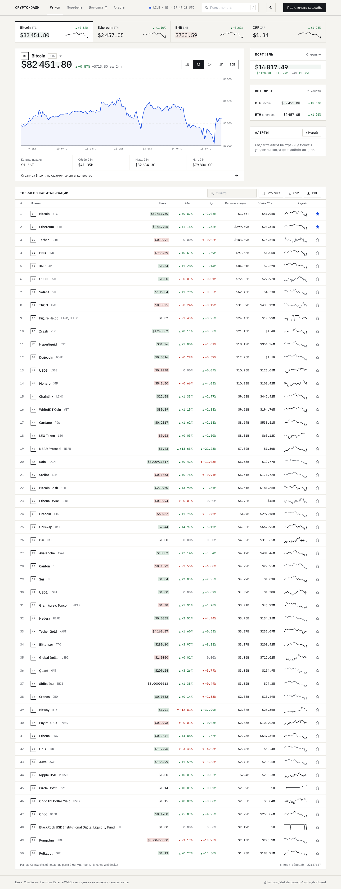
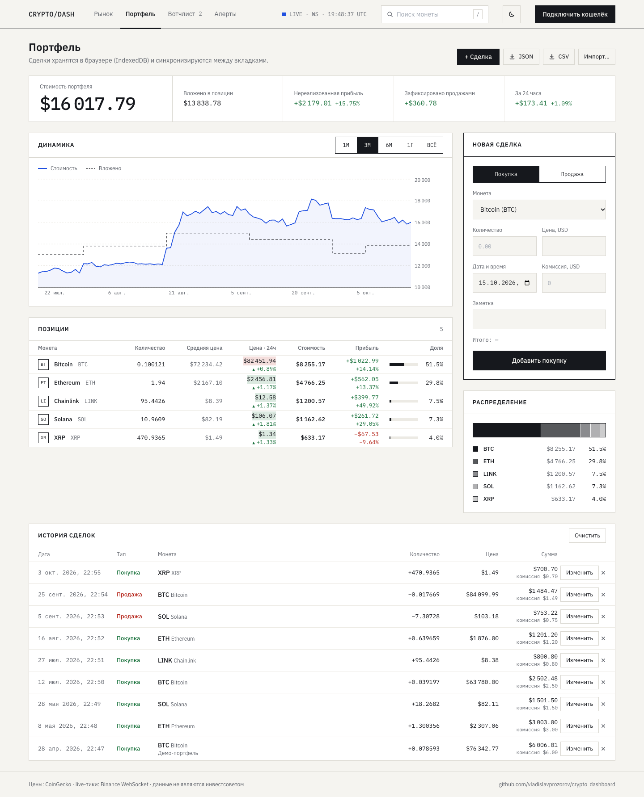
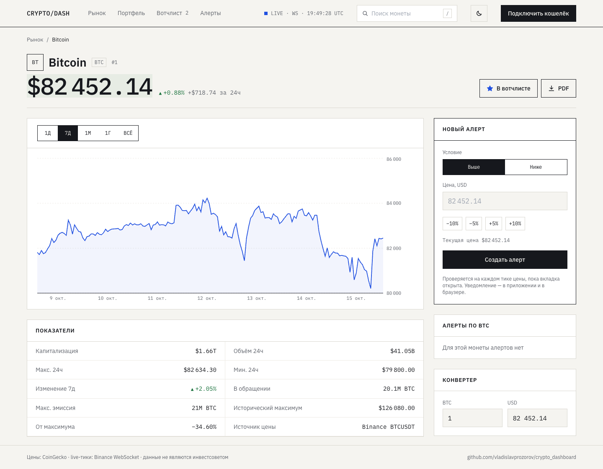
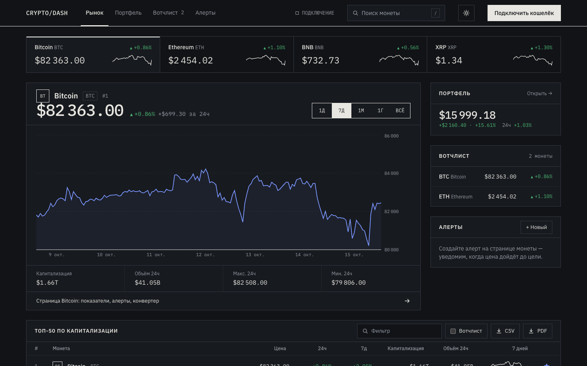
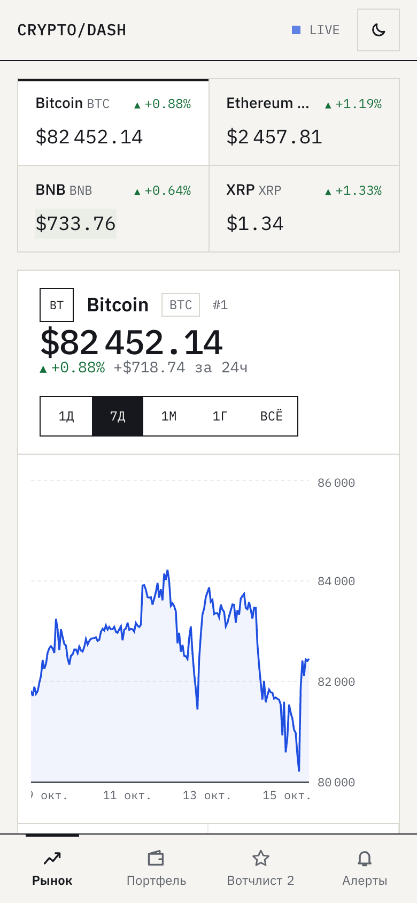
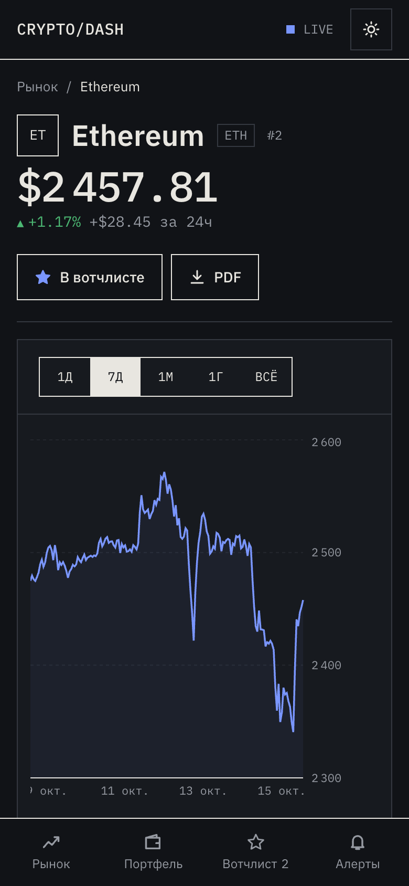
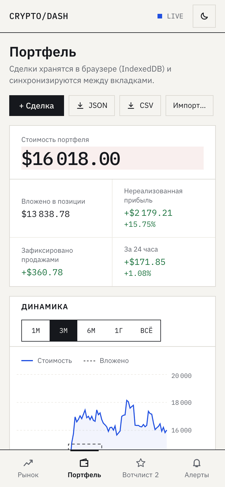

# Crypto Dashboard

Дашборд криптовалютного рынка в реальном времени: live-цены по WebSocket, портфель с расчётом прибыли, графики, вотчлист и ценовые алерты. Полностью клиентское приложение: живёт на GitHub Pages и работает без собственного бэкенда.

**Демо:** [vladislavprozorov.github.io/crypto_dashboard](https://vladislavprozorov.github.io/crypto_dashboard/)





<table>
  <tr>
    <td></td>
    <td></td>
  </tr>
</table>

<p>
  
  
  
</p>

## Возможности

- **Live-цены.** Одно WebSocket-соединение с Binance на все монеты списка. Цена подсвечивается при каждом тике, последняя точка графика двигается вместе с рынком.
- **Портфель.** Учёт покупок и продаж с комиссиями. Средняя цена, нереализованная и зафиксированная прибыль, изменение за 24 часа — всё по live-ценам. График «стоимость против вложенного» восстанавливает остатки на каждый день по дневным свечам Binance. Есть распределение по монетам, редактирование сделок, импорт и экспорт JSON/CSV с построчной валидацией и демо-портфель по реальным историческим ценам. Сделки хранятся в IndexedDB и синхронизируются между вкладками.
- **Рынок.** Топ-50 по капитализации: сортировка по любому столбцу (TanStack Table), фильтр, спарклайны за 7 дней, экспорт в CSV и PDF.
- **График** с периодами 1Д / 7Д / 1М / 1Г / ВСЁ, «круглыми» делениями осей и линиями активных алертов.
- **Страница монеты:** показатели (капитализация, эмиссия, ATH, расстояние до максимума), описание проекта, конвертер монета ↔ USD.
- **Вотчлист** хранится в localStorage и синхронизируется между открытыми вкладками. Избранное из прошлой версии приложения переносится автоматически.
- **Ценовые алерты** «выше/ниже» проверяются на каждом тике. Срабатывание показывается тостом и браузерным уведомлением. Есть быстрые пресеты ±5/10 %, а условие подсказывается по введённой цене.
- **Поиск** в шапке: комбобокс с клавиатурной навигацией, `/` ставит фокус.
- **Светлая и тёмная темы** без вспышки при загрузке, адаптивная вёрстка с нижней навигацией на телефоне.
- Подключение кошелька **MetaMask**.

## Как устроены данные

```
CoinGecko /coins/markets ──┐        (раз в 2 минуты)
   │ ошибка / 429          │
   ▼                       ▼
снимок в localStorage ──► список рынка ──► useCoins() ◄── live-стор ◄── Binance WebSocket
   │ старше суток                              ▲          (flush 1 раз/с)   (<pair>@miniTicker)
   ▼                                           │
Binance /ticker/24hr (упрощённый режим)        └── графики: Binance klines, иначе CoinGecko market_chart
```

У бесплатного CoinGecko жёсткие лимиты, а демо открывают с чистым кэшем. Поэтому список рынка грузится каскадом: CoinGecko, затем сохранённый снимок, затем упрощённый режим по данным Binance. Внизу таблицы всегда видно, какой источник сейчас используется.

### Инженерные решения

- **Расчёт портфеля — чистые функции.** Метод средней цены, сделки упорядочиваются по дате, а не по порядку ввода. Продажа сверх остатка не исполняется, а подсвечивается в истории. Форма не даёт продать больше, чем было на руках на дату сделки.
- **Хранилище портфеля за интерфейсом репозитория**: IndexedDB в браузере, реализация в памяти в тестах. Обновления оптимистичные с откатом при ошибке записи, другие вкладки узнают об изменениях через BroadcastChannel.

- **Пакетные обновления.** Тики копятся в сторе вне React и публикуются раз в секунду через `useSyncExternalStore`. Интерфейс не перерисовывается на каждое из десятков сообщений в секунду.
- **Надёжный WebSocket.** Экспоненциальная задержка с джиттером, сторожевой таймер на «тихое» соединение, пауза при `offline`.
- **Свежесть потока считается по локальному времени получения**, а не по серверному времени тика: у пользователя часы могут спешить, и индикатор LIVE иначе врал бы.
- **Защита от коллизий тикеров.** Подписка идёт только на реально торгуемые пары. Если цена Binance расходится с CoinGecko больше чем на 20 %, тикер считается другой монетой с тем же символом.
- Используется публичное зеркало `data-stream.binance.vision`, без ключей и без гео-блокировки `api.binance.com`.
- **jsPDF подгружается по клику**, страницы — лениво. React, Query и Recharts вынесены в отдельные чанки.
- **HashRouter**, потому что GitHub Pages не умеет отдавать `index.html` на произвольные пути.
- Доступность: настоящие кнопки и ссылки, `aria-sort` в таблице, `radiogroup` со стрелками для периодов, `combobox` для поиска, изменение цены передаётся знаком и стрелкой, а не только цветом.

## Дизайн

Плоская «биржевая ведомость»: бумажный фон, тонкие линейки вместо теней, IBM Plex Sans + IBM Plex Mono с табличными цифрами, один синий акцент. Без градиентов, свечения и стекла. Токены цветов — CSS-переменные, и тёмная тема переопределяет только их.

## Стек

React 19 · TypeScript (strict) · Vite · Tailwind CSS · TanStack Query · TanStack Table · Recharts · Framer Motion · Axios · jsPDF · MetaMask · Vitest + Testing Library · Cypress · ESLint + Prettier · husky + lint-staged · GitHub Actions

## Структура (Feature-Sliced Design)

```
src/
├── app/            # bootstrap, провайдеры, роутер, layout с шапкой и мобильной навигацией
├── pages/          # dashboard, portfolio, coin, watchlist, alerts
├── widgets/        # portfolio/ (сводка, позиции, распределение, график), MarketStrip, ChartPanel, MarketTable, SidePanels, CoinSearch, LiveStatus…
├── features/
│   ├── live-prices/   # WebSocket-провайдер, стор тиков, useCoins (рынок + live)
│   ├── portfolio/     # расчёт P&L, IndexedDB-репозиторий, стор, импорт/экспорт, форма сделки
│   ├── alerts/        # модель и проверка алертов, форма, список
│   ├── watchlist/     # хранилище и кнопка-звезда
│   ├── export/        # CSV / PDF
│   └── theme/
├── entities/       # coin — типы и запросы (рынок, история, профиль, каскад источников); transaction
└── shared/
    ├── api/        # клиенты CoinGecko и Binance
    ├── lib/        # форматирование, деления осей, localStorage-хранилище, WebSocket
    └── ui/         # Panel, Segmented, PriceChart, Sparkline, LivePrice, Toaster, иконки
```

## Запуск

```bash
npm install
npm run dev        # http://localhost:5173/crypto_dashboard/
npm test           # unit- и компонентные тесты (Vitest)
npm run lint
npm run build      # сборка в dist/, деплой на GitHub Pages — через GitHub Actions
```

Переменная `VITE_COINGECKO_API` в `.env` (необязательная) задаёт базовый URL CoinGecko.

## Тесты

83 теста на Vitest: расчёт портфеля (средняя цена, частичные продажи, порядок по дате, продажи сверх остатка, история стоимости), импорт/экспорт и валидация CSV/JSON, стор портфеля с откатом и синхронизацией вкладок, форма сделки, форматирование чисел, деления осей, проверка алертов, разбор сообщений Binance, переподключение WebSocket на фейковых таймерах, каскад источников рынка, наложение live-цен и защита от коллизий, стор тиков, компоненты `Change` и `WatchToggle`. E2E-сценарии Cypress (`cypress/e2e`) покрывают поиск, вотчлист, создание алерта и ведение портфеля.

## Ограничения

Алерты проверяются, пока вкладка открыта: без сервера фоновых push-уведомлений нет. Следующий шаг — небольшой бэкенд (Node + PostgreSQL) с хранением алертов и Web Push.

---

Автор: [vladislavprozorov](https://github.com/vladislavprozorov)
